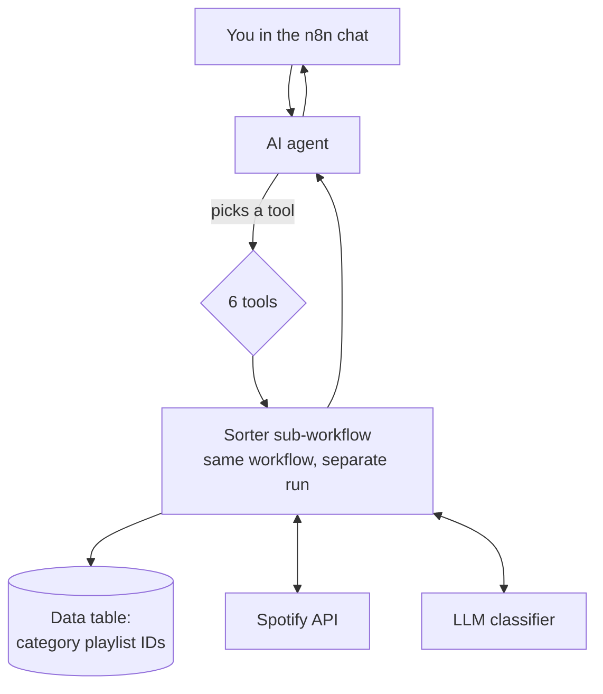

# How it works

## Overview

The chat trigger and agent are the user-facing part. The six tools all call the same sorter, each with a different `action`.

## The six tools

| Tool | What it does |
|---|---|
| **List categories** | Shows your category playlists, their rules and song counts |
| **Create categories** | Creates new playlists and registers them. Skips names that already exist |
| **Adopt playlist** | Registers a playlist you already own as a category. Name and songs stay as they are |
| **Sort liked songs** | Sorts every Liked Song that is not in a category yet |
| **Retry unsorted songs** | Gives songs in the Unsorted playlist a second look (up to 100 per call) |
| **Re-check songs** | Reviews songs already in a playlist (by default the catch-all) and moves misplaced ones |

## The sorter, step by step

1. **Settings**: loads options.
2. **Read Registry** and **Registry Snapshot**: read the data table of category playlists.
3. **Get Me**, **Get Playlist Total**, **Plan Playlist Pages**, **Fetch My Playlists**: read your Spotify playlists.
4. **Load Categories**: joins the live playlists with the data table by playlist ID. Registered playlists that no longer exist in Spotify are ignored and reported.
5. **Route Action**: sends the request to the right lane (list, create, sort/retry/re-check, adopt).
6. For a sort, the workflow reads every playlist it manages (the "known set") and all Liked Songs, and keeps only the songs not in any of them.
7. New songs are processed in a **loop of batches of 50**: build a prompt, classify with the LLM, parse the answer, add the songs to their playlists.
8. **Run Summary** reports what happened to the agent.

## Design decisions

**Categories are tracked by Spotify playlist ID, not by name.** An earlier version identified playlists by a name prefix, which broke as soon as a user renamed a playlist. The data table stores `playlistId`, `role` (category or unsorted), `rule` (what belongs there) and `isDefault` (catch-all). Playlists can be renamed freely.

**Only new songs are processed.** Sorting compares your Liked Songs against the playlists the workflow manages. A guard throws an error if the known set does not match the playlists' reported sizes, so a partial read can never cause songs to be sorted twice.

**The loop lives in the workflow, not in the agent.** The agent model does not reliably repeat tool calls, so one "sort" call processes the entire library inside the workflow. The agent only decides what to run.

**Index-keyed LLM output.** The model returns an object per song with its position number: `{n, genre, category}`. Parsing matches answers by `n`, so a missing or extra entry affects only that song instead of shifting every answer after it. Missing or invalid answers are reported as unreadable and the songs go to Unsorted (or stay where they are on a retry).

**Retries are safe to repeat.** On a retry, moved songs are removed from the source playlist first, then any existing copies in the target are cleared, then the songs are added. Running it again cannot create duplicates.

**Classification uses the model's own knowledge.** Spotify no longer shares artist genres through its API, so the LLM classifies from the song title, artist, album and release year, using its own knowledge of the music.

## Where the runs show up

Tool calls run the sorter as a separate execution. In n8n's **Executions** tab they appear as runs of mode "integrated". The chat run on the canvas shows only the agent, which is why the sorter nodes do not light up on the canvas.
